# labhud

A wall-mounted status display for your homelab. One page, designed for an old phone or tablet
on the wall: hosts, VMs, network, storage, backups and media at a glance, with live updates.

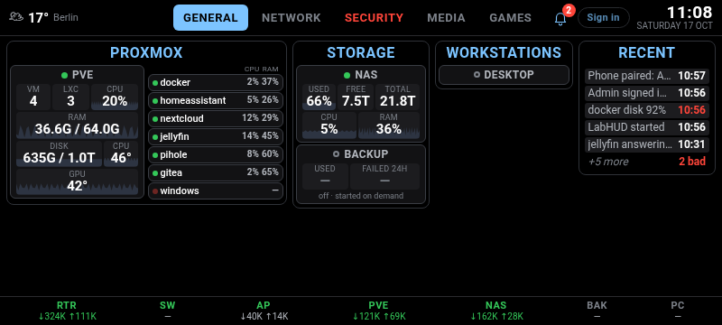

- **Zero dependencies.** Python standard library on the server, plain JS in the browser, no build step.
- **No secrets in the browser.** One server talks to your services; the screen only receives a
  snapshot over Server-Sent Events.
- **A setup page on first start.** Start it on an empty folder, open the link from its log, and
  it walks you through Proxmox (nodes, VMs, LXCs), every other service (tried before it is
  kept) and the display, then writes the config and starts. After that, ⚙ on the display (or
  the `labhud` command) changes everything.
- **Optional sources.** Proxmox VE (guests, backups, snapshots, storage running out), Proxmox
  Backup Server, OPNsense, Synology DSM, OpenMediaVault, Docker (with `labhud.*` labels), a UPS
  through NUT, certificate expiry, Technitium / Pi-hole / AdGuard, Beszel, Uptime Kuma,
  Healthchecks, Scrutiny, Traefik, What's Up Docker, qBittorrent, the *arr apps, Jellyfin,
  Navidrome, Seerr, Immich, Speedtest Tracker, Home Assistant, game servers (Steam A2S,
  Minecraft), RSS, GitHub releases, a CalDAV calendar: each one turns on when you give it a URL
  and a key. Any other JSON API comes in without code.
- **Made for a wall.** Problems take the screen; numbers past a mark notify after 5 minutes, not
  on every spike; a calm mode shows only the clock when all is well; Fully Kiosk's screen goes
  off at night; a separate public status page shows names and states only.
- **Its own agents.** `labhud-agent` (one small Go binary or container per host) pairs with a
  one-time code from ⚙ > Agents and does only what you tick there: sensors and charts, Docker
  containers (start, stop, update, logs), systemd services, Proxmox guests, Pterodactyl game
  servers, Wake-on-LAN, the host's reboot and updates; private registries, and the images' CVEs
  with trivy or grype (an update with new critical ones can wait). See [docs/agents.md](docs/agents.md).
- **Set up from the screen.** ⚙ holds everything: sources (tried before they are kept, or found
  by scanning your network), pages and groups by drag and drop, agents, alert rules, phones, the
  PIN, the config file itself. The `labhud` command does the same from a terminal
  ([docs/cli.md](docs/cli.md)).
- **Alerts on hosts.** CPU, RAM, disk, temperature or an agent gone for some minutes, on one host
  or on every one; quiet hours. Sent to the app, ntfy, email, a webhook, Discord or Gotify, each
  with a test, and a table of which news goes where (a host down, an update, an admin sign-in…).
- **One admin, with two factors.** A password and an authenticator app, or single sign-on
  (OpenID Connect: Authentik, Keycloak…), from the admin's networks only if you list them. A
  screen or phone that is not signed in only looks: no buttons, no ⚙.
- **API tokens and an audit log.** Tokens for scripts (`read`, `act` or `admin`, shown once, only
  their hash kept) and a log of every sign-in, change and refusal, kept 90 days (⚙ > System >
  API & audit).
- **A PIN for a screen anyone walks by.** With a 4-digit PIN, a signed-in screen goes back to only
  looking after 2 minutes without a touch. Only a scrypt hash is kept; wrong guesses are slowed.
- **A phone app.** [LabHUD for Android](https://github.com/Mithrandler/labhud-android) pairs with a
  QR code and shows the wall's pages, the devices, the timeline and the alerts; signed in as the
  admin, its buttons work after the PIN or a fingerprint. Instant notifications through
  UnifiedPush, with nothing of the news leaving your network. See [docs/app-api.md](docs/app-api.md).
- **Each screen its own look.** The ⚙ next to the clock sets, for that screen only: OLED black or
  dark grey, an accent colour, the font and text size, which pages rotate and how fast, and its
  own night and calm hours.
- **Backup and restore** from ⚙ > System: config.toml and labhud's data in one file, the secrets
  only encrypted with a password; a daily one keeps the last few.
- **HTTPS by default**, with labhud's own certificate, pinned by the app and the agents.
- **Demo mode** with made-up data, so you can try it without touching your lab.

> [!WARNING]
> **Looking needs no login.** The page shows your internal addresses; its buttons need the admin
> (and the display's PIN, if you set one). Keep it behind a
> firewall rule that lets only the display in, or behind a VPN. See [docs/security.md](docs/security.md).

## In five steps

1. **Start it** on an empty data folder (Docker Compose in [docs/install.md](docs/install.md)) and
   open the link with the setup code from its log.
2. **Make the admin**: user, password, and the code from your authenticator app.
3. **Add your sources**: Proxmox first, then the rest, each tried before it is kept; or ⚙ >
   Sources > Scan my network.
4. **Add agents** from ⚙ > Agents > Add an agent: one line on each host, then tick what it may do.
5. **Pair your phone** from ⚙ > Phones (the QR code), and put the display on the wall.

## Try it

```sh
docker run --rm -p 127.0.0.1:8095:8095 -e LABHUD_DEMO=1 ghcr.io/mithrandler/labhud:latest
```

Then open <http://localhost:8095>. No keys, no network access, nothing from your lab.

## Install

[docs/install.md](docs/install.md): config, keys, Docker Compose, the display, updates.

| | |
|---|---|
| 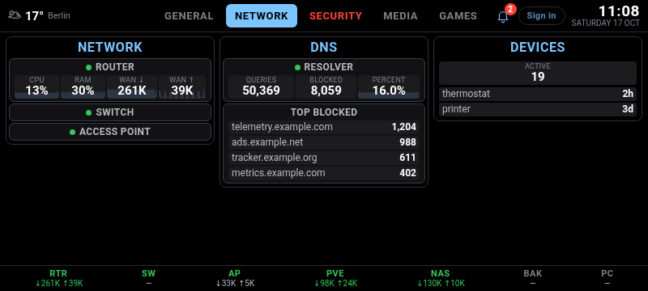 | 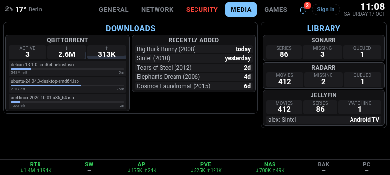 |
| 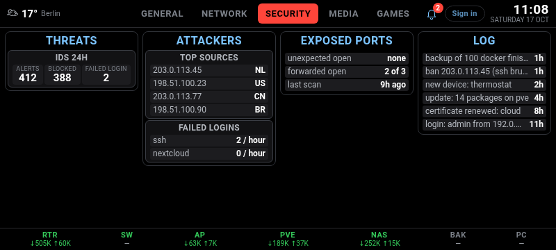 | 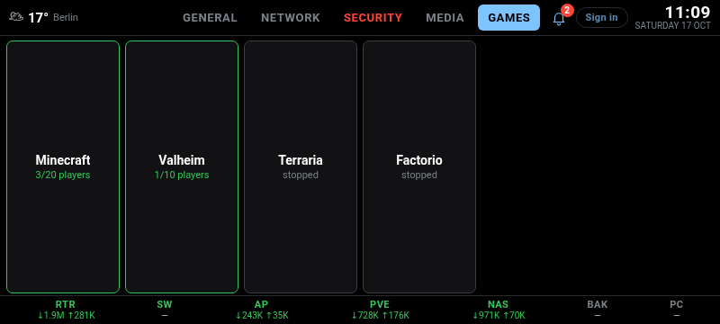 |

In portrait the same page gets two columns, and the project name takes the free middle of the top bar:

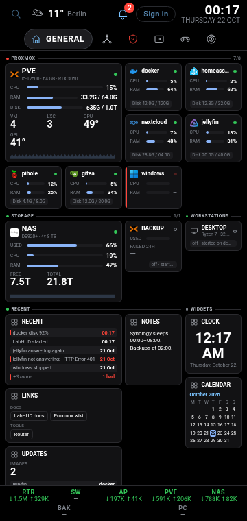

Signed in as the admin, ⚙ changes everything on the display itself: the look, the pages, the
alerts, the sources, the phones and the agents.

| | |
|---|---|
| 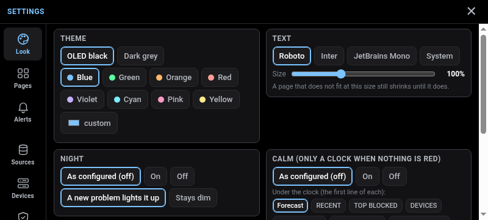 | 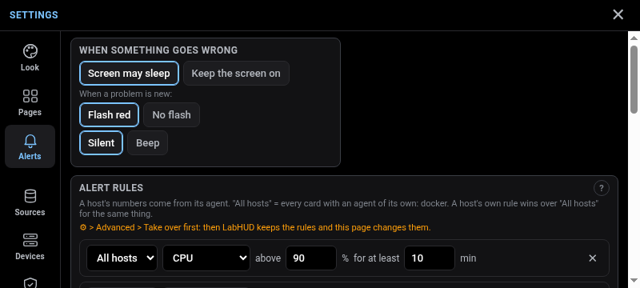 |
| 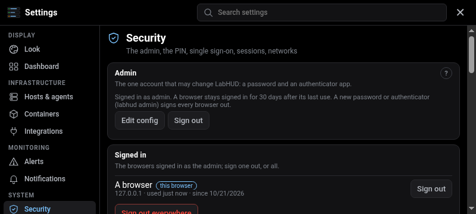 | 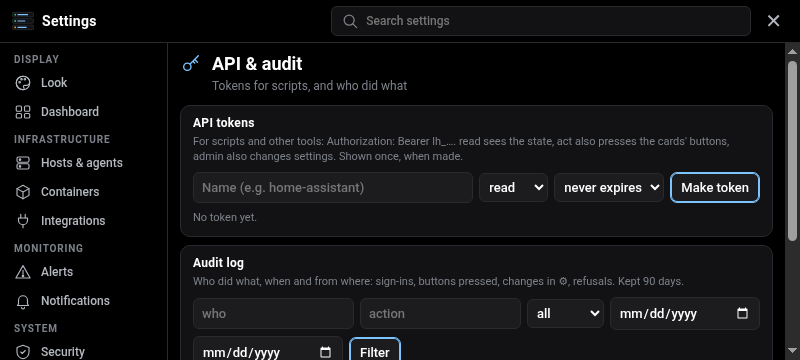 |
| 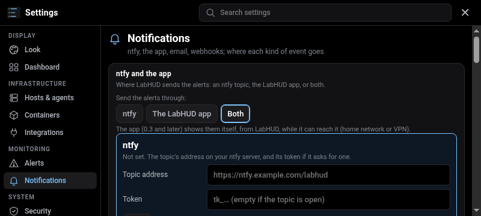 | |

## Docs

- [docs/install.md](docs/install.md): installing and updating; `/status` for what is not working
- [docs/sources.md](docs/sources.md): per service, the key to create, the least rights it needs, a card to start from
- [docs/security.md](docs/security.md): what the page reveals and what to put in front of it
- [docs/architecture.md](docs/architecture.md): every connection, its direction, port and key
- [docs/threat-model.md](docs/threat-model.md): what labhud protects, against whom, and the known gaps
- [docs/live-agent.md](docs/live-agent.md): your own data (alerts, DNS, logins, game servers) as one JSON document
- [docs/actions.md](docs/actions.md): buttons that wake hosts or start VMs, signed for the agent (off by default)
- [docs/app-api.md](docs/app-api.md): the API of the Android app, pairing and phone tokens
- [docs/agents.md](docs/agents.md): labhud's own agents: install, pair, what each capability may do
- [docs/cli.md](docs/cli.md): the `labhud` command, everything ⚙ does from a terminal
- [docs/integrations.md](docs/integrations.md): Docker, NUT, certificates, DNS filters, Beszel, Uptime Kuma, Healthchecks, Scrutiny, Traefik, feeds, the screen, the public page, MQTT and Home Assistant
- [config.example.toml](config.example.toml): every config option, commented
- [.env.example](.env.example): every source and the variables it reads
- [CHANGELOG.md](CHANGELOG.md) · [docs/ROADMAP.md](docs/ROADMAP.md)

## Development

Standard library only, so the tests need nothing but Python 3.11+ (and Node for the syntax check):

```sh
LABHUD_DEMO=1 python3 server.py                # the demo, on http://localhost:8095
python3 -m unittest discover -s tests -t .     # config loader, source parsers, demo smoke test
node --check static/app.js
```

The colours and icons live in `design/tokens.json`, the one place for the wall, ⚙, the setup
pages and the Android app: after a change, `python3 design/build.py` (add `--android
../labhud-android` for the app's `Tokens.kt`); a test fails while a page is not what it makes. The pictures in
`docs/screenshots` come from the demo: `node design/shoot.mjs <demo URL> [admin ticket]` (how to
start the demo and a headless Chromium for it is at the top of the script).

The source tests run on made-up API answers in `tests/fixtures/`, one file per service, keyed by
a fragment of the requested URL. CI (`.github/workflows/ci.yml`) runs the same commands, then
builds the image for linux/amd64 and linux/arm64; a `vX.Y.Z` tag publishes it, once
`CHANGELOG.md` has an entry for that version.

## License

[MIT](LICENSE). The bundled Roboto fonts are under the
[SIL Open Font License 1.1](static/fonts/OFL.txt). The service icons come from
[homarr-labs/dashboard-icons](https://github.com/homarr-labs/dashboard-icons) (Apache-2.0, see
`static/icons/svc/LICENSE`).
